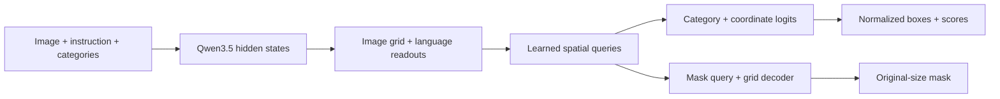

# Spatial decision models

Valen-Decision-Det, Valen-Decision-Seg and Valen-Decision-GUI share Qwen3.5 loading,
adaptation, checkpointing and distributed utilities. The `qwen_spatial` backend
has a typed spatial compiler and supervised objective; the existing categorical
decision backend remains unchanged.

The head reads the contextual image-token grid, instruction readout and category
readouts. A small query decoder predicts category/no-object logits and four
coordinate distributions. Their expectations decode to normalized boxes. Set
matching supervises multiple objects. Referring and GUI requests supply one
target category; GUI clicks use the highest-scoring box center.

Segmentation uses a language-conditioned mask query and a spatial upsampling
decoder. Its binary mask is restored to the original image size. It uses genuine
mask supervision and BCE/Dice loss. No external detector or segmentation model,
vocabulary projection or autoregressive coordinate generation is used.



For an image grid `h × w` and backbone width `d`, image features have shape
`(h*w, d)`. Two decoder layers project to width 256. Det uses 100 queries and GUI
uses one: logits are `(Q, C+1)` for categories/background and `(Q, 4, 512)` for
center/size bins. Bin expectations decode to `xyxy`. Hungarian matching penalizes
unmatched queries as background; inference keeps valid boxes ordered by confidence.
Seg uses one query and a 4× upsampled grid before restoration to the original size;
multiple annotated instances for a phrase are combined by mask union.

Coordinate-bin queries share one bbox implementation across variable-category Det
and single-target GUI tasks. A dense spatial heatmap was the alternative: it gives
an explicit location score per grid cell but needs finer grids for tiny controls.
The selected query head keeps its output at `Q × 4 × 512`; an uncertain distribution
can average several locations, so it needs separate small-target diagnostics.
The default bbox loss is `classification + coordinate CE + 5 × L1 + 2 × (1 − GIoU)`;
unmatched queries have background weight 0.1. Seg uses
BCE + Dice + `0.1 × presence classification`, with ignore pixels excluded.

Head parameter counts follow the backbone width, including the query decoder:

| Size | Backbone width | Det head | Seg head | GUI head |
| --- | ---: | ---: | ---: | ---: |
| 0.8B | 1,024 | 3.12M | 2.75M | 3.10M |
| 2B | 2,048 | 3.39M | 3.01M | 3.36M |
| 4B | 2,560 | 3.52M | 3.15M | 3.49M |
| 9B | 4,096 | 3.91M | 3.54M | 3.89M |

Confidence is the foreground-category softmax score. Boxes are sorted by score;
set matching provides duplicate supervision and inference applies no NMS. GUI
and referring localization use the first box. Protocols allowing an absent target
set `meta.allow_empty_target=true` consistently for every record, so background
class winners can be removed without revealing whether a particular target exists.
The processor resizes the complete image without cropping or letterboxing. The
compiler retains original dimensions and the processed token grid; normalized
boxes need no extra offset, and masks are interpolated back to the original size.

Inference records omit training targets. For example, a GUI request is:

```python
record = {
    "id": "example", "group_id": "example-image",
    "request": {
        "state": {"messages": [{"role": "user", "content": [
            {"type": "image_url", "image_url": {"url": "images/example.jpg"}}
        ]}]},
        "questions": {"target": {"type": "gui", "instructions": "Open Settings",
                                 "categories": ["target"]}}
    }
}
response = model.predict(record, media_root="data")
prediction = response["answers"]["target"]
```

The GUI prediction contains normalized `boxes` with category/score and their
highest-scoring center in `point`; each box is `[x1, y1, x2, y2]`. Current Det models
use the same schema with `type="det"`, `categories=["target"]` and the referring
expression in `instructions`. Set `record["meta"] = {"referring": True}` to request
the highest-scoring box, matching the training and evaluation convention.
Seg uses `type="seg"` and returns `mask={"size": [height, width], "counts": ...}`
as original-resolution COCO RLE with a confidence score.

The main implementation points are the [spatial compiler](../valen/data/spatial.py),
[model-independent supervision types](../valen/data/types.py),
[shared task head/backend](../valen/modeling/qwen/spatial.py),
[supervised objective](../valen/training/spatial_loss.py),
[training loop](../valen/training/spatial.py) and
[standalone exporter](../scripts/export/qwen/export_spatial.py).
The existing choice compiler, candidate heads and RLCD objective keep their APIs.

The bf16 backbone alone uses approximately 1.59/4.12/8.46/15.63 GiB per GPU for
0.8B/2B/4B/9B. This excludes activations, trainable parameters, optimizer state and
workspace. Joint training uses rank-32 LoRA, the visual merger and the new head,
with activation checkpointing and a global batch of 32 records. Actual peak memory
and latency are measured in each run; these storage estimates are not measured peaks.
Distributed training replicates the model, so these per-card costs are not divided
by the number of ranks. For FP32 trainable parameters with AdamW, budget about 16 bytes per
parameter for weights, gradients and optimizer moments, plus activations and
workspace. LoRA planning allowances at up to 1MP are 8/16/24/40 GiB per card for
the four sizes. Full 0.8B/2B comparisons reserve 32/64 GiB per card. Det 4B Full has a provisional
112 GiB per-card allowance and requires an actual sixteen-GPU memory/gradient
check before formal training. These are
planning margins; each run records actual peak memory and its input budget.

Spatial training currently requests `attn_implementation="sdpa"`. PyTorch selects
the compatible attention kernel at runtime; installing `flash-attn` alone does
not select the external `flash_attention_2` backend. Qwen3.5's linear-attention
layers separately require compatible `flash-linear-attention` and `causal-conv1d`
packages for their fast path. Verify actual forward/backward operators, finite
gradients and throughput on training samples before changing a run. Compare
activation checkpointing and batching with the same data and global batch;
record GPU compute utilization separately from memory occupancy and retain
memory headroom for validation and the longest inputs.

Full training can explicitly change the GPU count with
`--training-world-size 64 --nodes 16 --gpus-per-node 4`. The retained warmup
head is reused with a new optimizer; prior Full weights are not used. With two
records accumulated per GPU, the global batch becomes 128 and a 100k epoch has
782 updates. Warmup and validation/save intervals scale by examples: 25 warmup
updates and a 32-update interval for the 16-to-64 GPU configuration. Learning
rates remain unchanged and gradient synchronization uses 128 MiB buckets.
Reports identify the changed training batch rather than treating it as a
matched-batch LoRA/Full ablation; evaluation inputs and scoring remain matched.

Spatial RLCD follows the repository's grouped policy optimization and confidence
calibration design. Its defaults are in
[`configs/train/qwen/det/rlcd.json`](../configs/train/qwen/det/rlcd.json).
Each accepted, standalone merged SFT LoRA model first replays its sealed 100k training records. All
remaining errors are used up to 20k; larger pools are sampled with source and
image balancing, seed 42. Records and instructions remain unchanged. Evaluation
data never enter this selection or its rewards.

The policy samples NULL or a query plus four center/size coordinate bins. Joint
log probabilities and fixed-reference KL include both presence and conditional
box distributions. Reward combines IoU, the 0.5-IoU hit criterion and confidence
calibration; an incorrect presence decision receives a negative reward. Group
advantages are exactly zero for constant rewards. Two clipped policy updates
reuse the same sampled actions, old probabilities and rewards. Fresh language
LoRA adapters, the spatial head and visual merger train; the remaining language
and vision backbone parameters stay frozen. The fixed reference is the original
merged SFT LoRA export. Existing Full models serve only as evaluation comparisons.
Trainable head, adapter and merger weights use FP32; the frozen backbone uses
BF16 with BF16 autocast. The standalone export preserves the FP32 merger and
reconstructs the merged SFT base before loading and merging the new RL adapters.

The pipeline checks real adapter/head/merger updates, unchanged frozen backbone
weights and checkpoint restore before completing
the selected-data epoch. Development accuracy, with mean IoU as the tie breaker,
selects the best checkpoint and may retain the original merged policy if RL worsens
development performance. All eleven evaluation items are repeated with matched
inference settings. Reports compare LoRA, Full and LoRA-RLCD, plus original-100k
and hard-subset errors before and after RL. A verified zero-error replay records
a skip and creates no placeholder model package.

Train the new head first, then jointly adapt language LoRA and the visual merger.
Det training normally uses sixteen GPUs per model; GUI and Seg use eight.
Reserved GPUs total at most 80. The completed 2B Full override used 64 existing GPUs
with global batch 128. The completed 2B LoRA-RLCD used the same topology.
The current override trains GUI 2B LoRA on the expanded 172k corpus with all 64 GPUs,
global batch 128, one head-warmup epoch and one joint epoch. Other runs stay paused.
Pass `--training-samples 172000` to check the expanded seal and complete both
1,344-step epochs. Keep the previous 100k model as a separate measured baseline.
`--training-world-size 64` records the changed topology, keeps learning rates,
and scales warmup and checkpoint intervals by examples. A per-job `data_root`
binds training, development, evaluation and examples to the same sealed revision.
The scheduler's `--reuse-allocations` option keeps existing replicas for a queue of
models. Each model belongs to one allocation. Queues may mix sizes when the reserved
hardware fits each model; commands use the model's own backbone and configuration.
Only runs that have not started may be reassigned. Set their registry `after_queue`
flag to append them after the destination's existing pipelines and examples, preserving
the active task and avoiding an unready comparison delaying those examples.
An allocation's optional `extra_tasks` can insert a diagnostic command after a named
pipeline. Such a command becomes ready only after that pipeline completes. When it
must precede the next model, include its completion marker in that model's
`requires_files`; ready-task scheduling otherwise permits unrelated work to proceed.
Additional eight-GPU workers
can queue before data preparation finishes and start after their audited inputs are
ready. Existing allocations continue their assigned models after the initial pipeline
finishes training, export and evaluation. Each worker releases its cards after its
queue finishes. Failed tasks retain
the allocation for diagnosis; an allocation's `STOP` file ends its workers.
A 900-second monitor records allocation state, per-model progress, loss and GPU telemetry,
and counts each allocation once against the 80-GPU limit.
Two disjoint eight-GPU leases can form a sixteen-GPU execution group through a
configured hostname-to-rank map. Child processes receive logical ranks; physical
lease environments remain unchanged for later eight-GPU work. Monitoring queries
all physical leases and counts their cards once. New requests allocate eight CPU
cores and 64 GiB RAM per GPU: 128 cores/1 TiB for Det, 64 cores/512 GiB for GUI/Seg.
Machine-specific paths and job state belong in ignored experiment directories.

Preparation tools are under `scripts/data/`. For the initial mixed-task data,
run `python -m scripts.data.finalize_spatial --data-root "$VALEN_DATA_ROOT" --task "$TASK"`
with `TASK=det`, `seg` or `gui` after all original suites are prepared. The audit verifies image hashes,
annotation dimensions, original masks, independent files and the 100k sample count.
It keeps one annotation sheet and its small `manifests/samples.json` provenance
record; the sheet is refreshed when the training-list fingerprint changes.
Formal pipelines require this seal and reject changed training/development inputs.
Det uses 100k original RefCOCO-family and ReasonSeg instructions, without COCO
category-detection records. Run
`python -m scripts.data.prepare_det_referring --data-root "$VALEN_DATA_ROOT" --source-root "$REFCOCO_SOURCE"`
to stage the revision; add `--activate` only after stopping obsolete Det readers.
This command publishes the current Det seal. Once activated, rerunning it checks
the canonical training/development hashes; do not rerun the original Det finalizer
over the referring-only revision.
Image-balanced selection caps referring examples at 12 per image, deduplicates
instruction/target pairs and excludes all protected evaluation images. Keep all
1,324 ReasonSeg train instructions and sample the remaining 98,676 examples from
the three referring sources. Det uses 16 ranks with two accumulation steps, keeping
the global batch at 32. The development list is `eval/det/processed/dev.jsonl`,
with 512 referring val records and all 200 ReasonSeg val records; media stay within
`eval/det`. RefCOCO uses its original COCO images, stored independently per task.
The Det evaluator defaults to the eight referring splits; ReasonSeg val/test run
as a separate complete supplement. COCO evaluation is retained only for explicitly
selected historical protocols. See [Det evaluation](../evaluation/det/README.md).

Each logical node in a four-node Det group starts the same complete pipeline:

```bash
python -m scripts.train.run_spatial_pipeline --task det \
  --model-path "$MODEL_PATH" --data-root "$VALEN_DATA_ROOT" \
  --output-dir "$RUN_DIR" --export-dir "$EXPORT_DIR" \
  --nodes 4 --gpus-per-node 4 --launch-id "$RUN_ID" --with-reasonseg
```

The worker sets `KUBEBRAIN_REPLICA` to a unique logical rank from 0 through 3 and
`KUBEBRAIN_REPLICA_TOTAL=4`. All nodes share the run directory and use a fresh
launch ID. GUI/Seg use their task profiles with two nodes and four GPUs per node.
PhraseCut uses the original integer-vertex polygon rasterization described in its
[evaluation utilities](https://github.com/ChenyunWu/PhraseCutDataset/blob/master/utils/data_transfer.py).

`scripts/train/run_spatial_pipeline.py` runs one complete head epoch, one joint
LoRA epoch, export/reload verification and the full required evaluation suite.
The frozen-backbone baseline sees the same corpus for one epoch; the final model
has two cumulative epochs. Best and latest share storage when identical; completed
exports retain metrics and remove obsolete optimizer checkpoints.

LoRA adapters are merged before the exporter's reference prediction is computed.
The manifest's `reload_validation` therefore compares the merged model with its
standalone reload; it does not measure the numerical change caused by merging
BF16 adapters. Keep any before/after-merge probe separate from this check. Formal
benchmark results are always measured on the exported model.

For LoRA/full comparisons, retain the completed warmup's best head with
`python -m scripts.train.spatial_comparison --retain-warmup "$BASELINE_RUN"`
before its original pipeline cleans checkpoints. Then use
`--finetuning-type full --baseline-run "$BASELINE_RUN"` with a distinct run/export
directory. The full run reuses that exact head and trains the entire language and
vision backbone, merger and head for one joint epoch. It keeps the reference's
data, seed, resolution, batch and benchmark protocol. Full-stage learning rates
are head `1e-4`, language `1e-5`, merger `1e-5`, vision `2e-6`; they are recorded
alongside the LoRA rates. FP32 trainable backbone weights use BF16 autocast and
retain both storage and compute precision on export. A compact `comparison.json`
reports per-benchmark full-minus-LoRA metrics, trainable parameters, training time,
peak memory, inference latency and model bytes. These comparisons reuse existing
reserved allocations. Current Det 0.8B/2B/4B Full runs wait for all three LoRA
models to complete the eight referring splits and both ReasonSeg splits; a
verified evaluation barrier releases the existing sixteen-GPU queues together.
Recorded training seconds sum the logged loop segments, including validation
and intermediate checkpoint work. They exclude model setup, work after the final
metric record, export and benchmark evaluation. Resumed segments are added rather
than replacing the time before a restart. GPU memory is the maximum allocated
memory recorded across ranks; the training peak can include model initialization.

The four backbone sizes use the same task schema and head implementation.
Dataset sources and progress are documented locally in `data/{det,seg,gui}.md`.
Public evaluation adapters live in `evaluation/{det,seg,gui}/` and accept external
data/model/output paths. See their READMEs for benchmark protocols and commands.

GUI desktop revisions are prepared separately before replacing a sealed corpus:

```bash
python -m scripts.data.prepare_gui_desktop \
  --existing-root "$VALEN_DATA_ROOT" --source-root "$GUI_SOURCE_ROOT" \
  --output-root "$GUI_REVISION_ROOT"
python -m scripts.data.install_gui_revision \
  --revision-root "$GUI_REVISION_ROOT" --data-root "$VALEN_DATA_ROOT" \
  --registry "$REGISTRY" --report "$INSTALL_REPORT"
```

The builder uses pinned GroundCUA and OS-Atlas desktop sources plus the existing
Web/Mobile corpus. It preserves original instructions, real boxes and image
resolution; filters invalid or ambiguous targets; excludes protected benchmark
images by file/pixel hashes and perceptual similarity; and keeps near-duplicate
components together across training and development. Source quotas are fixed
after cleaning and default to 100,000 unique records. Sampling covers screenshots
before adding another query, with a maximum of twelve records per image.
To expand a sealed 100k revision to exactly 172k, retain its records and fixed
development split with:

```bash
python -m scripts.data.prepare_gui_desktop \
  --existing-root "$VALEN_DATA_ROOT" --source-root "$GUI_SOURCE_ROOT" \
  --extend-from "$GUI_100K_ROOT" --output-root "$GUI_172K_ROOT" \
  --revision gui_desktop_172k_v3 --groundcua-records 80733 \
  --osatlas-desktop-records 17363 --web-records 30276 --mobile-records 43628
```

The extension preserves manual corrections, excludes previously rejected queries,
and applies the twelve-query limit across inherited and additional records.
Insufficient clean capacity is an error; records are never duplicated to fill quotas.
Perceptual similarity cannot establish session independence when source session
IDs are absent; the quality report records that limitation and original UI types.
The installer defaults to validation only. Add `--apply` after validation to
replace only `gui/` and `eval/gui/`, then delete their retired copies after
installed validation, retaining compressed baseline annotations for reproducibility.
It refuses active GUI jobs, preserves official benchmark
records, and verifies that Det inputs remain unchanged. Prior GUI models retain
their original data identity; changing a dataset does not retrain a model.

Collect partial or final results with
`python -m scripts.train.summarize_spatial --registry "$REGISTRY" --data-root "$VALEN_DATA_ROOT" --model-root "$MODEL_ROOT" --output-dir output/spatial-results`.
The scheduler's `--summary-dir` refreshes the same `summary.json` and `summary.md` files.
They include full benchmark/group metrics, measured training and inference costs,
artifact readiness and LoRA/full deltas, including ReasonSeg when both variants finish.
The current aggregate archive covers twelve LoRA models, seven Full comparisons
and the completed Det 2B RLCD run, for 20 artifact sets including paused sizes.
The 0.8B and 4B RLCD follow-ups were canceled.
An RLCD run with zero training errors requires an audited skip record. Missing benchmarks,
changed dataset fingerprints or an absent export remain incomplete.
Final acceptance also requires a few saved inference examples tied to the exact
export manifest. `python -m evaluation.examples` writes one compact image sheet
and a JSON report from fixed sample IDs, separately from complete benchmark
scores. The allocation scheduler appends these short inference tasks to existing
workers; it does not request another GPU allocation for them.

GroundingME is an evaluation-only Det supplement for all four LoRA sizes and
three Full controls. Run its complete 1,005-query test set with
`python -m evaluation.det.groundingme`; see the [Det protocol](../evaluation/det/README.md#groundingme).
The three initial Det LoRAs must complete this supplement before Full comparisons start.
